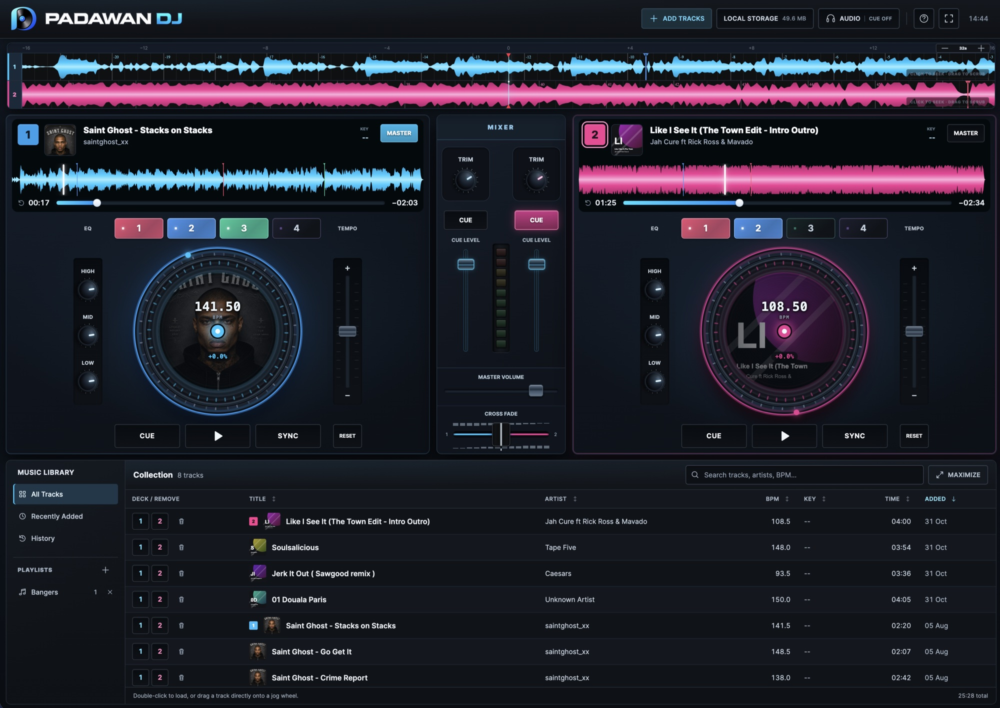

# Padawan DJ — v1.0.3

Two decks. One flow. Padawan DJ is a local-first DJ web application with hands-on mixing, interactive jog wheels, smooth waveforms and a music library that stays on your device. Built with plain HTML, CSS and JavaScript, it runs in your browser and can be installed as a PWA.



Try it on **[GitHub Pages](https://christianfallberg.github.io/padawan-dj/)**.

Padawan DJ is just static files, so you can also host your own copy anywhere: fork this repo and enable GitHub Pages, or upload the files to any web host. See [Host it yourself](#host-it-yourself).

## What is included

- Two playable audio decks
- Large interactive jog wheels
- Click/drag main waveforms and full-track overview waveforms
- Smooth, antialiased waveforms with zoom controls and a matching time ruler
- Four illuminated Hot Cue pads (1–4), saved per track
- Beatgrid, tempo, Sync, EQ, channel volume and master volume
- Large hardware-style crossfader with deck-colored rail, center marks and center snapping
- Separate headphone output selection and independent per-deck CUE levels
- Exclusive headphone CUE: selecting one deck turns off the other; click again to disable
- Segmented master level meter
- Drag tracks from Collection directly onto a jog wheel
- MP3 album artwork extraction with generated fallback covers
- Local Collection, playlists and history
- Maximizable music library (MAXIMIZE button or `L`; `Esc` restores) that keeps the waveform strip visible
- IndexedDB storage for audio files, artwork and track metadata
- PWA installation
- Offline app shell
- Refreshed deck controls, library, top-bar tools and app branding
- Audio, Local Storage and Help/About dialogs with outside-click dismissal
- Fixed-size About/Shortcuts dialog with scrollable shortcuts
- Fullscreen control where supported
- Storage usage meter
- Persistent-storage request
- Metadata/playlist/Hot Cue JSON export
- No build step and no backend: static files that can be hosted anywhere

## Run locally

Double-click `start.command`, or run:

```bash
python3 -m http.server 8080
```

Then open:

```text
http://localhost:8080
```

Any static file server works, for example `npx serve .`. Opening `index.html` directly from disk (`file://`) is not supported, because service workers and some storage APIs need an HTTP origin.

Keep using the same port: the browser stores the library per origin, so `localhost:8080` and `localhost:8081` have separate libraries.

## Local storage model

The interface can be hosted online while the music library remains local.

- Audio files, embedded artwork and track metadata are stored in IndexedDB.
- Playlists and history are stored in localStorage.
- Music is not uploaded to the hosting server.
- Storage belongs to the exact origin: protocol + domain + port.

These therefore have separate libraries:

```text
http://localhost:8080
https://dj.example.com
https://www.example.com
```

The library is also separate per browser and browser profile. Clearing site data removes it.

Open **LOCAL STORAGE** in the top bar to see storage usage and request persistent storage. Persistent storage reduces the chance that the browser evicts app data automatically, although manually clearing site data still removes it.

## Headphone monitoring

Open **AUDIO** in the top bar to detect and select a separate headphone output. Master audio uses the system default output; select a different device for headphones, then enable headphone monitoring. Device detection may request temporary microphone permission to reveal output names; the app immediately releases the microphone and does not record it.

Use the mixer’s **CUE** buttons to preview one deck at a time. Selecting the other deck switches monitoring to it; clicking the selected CUE again turns monitoring off. Each deck has its own CUE LEVEL, and the Audio dialog controls overall headphone volume.

Separate routing requires two audio outputs and browser support for `setSinkId()`. The app keeps headphone audio muted until a separate output is configured.

## Latest release: 1.0.3

See [release notes](CHANGELOG.md) for the version history.

- Short windows scroll when a pinned toolbar leaves too little room for the decks and library.
- The mobile toolbar fits its wrapped buttons, including Install App; touch devices get a labelled 44px toolbar reveal target.
- Adaptive deck controls with larger jog wheels where space allows, readable labels and clear KEY/MASTER spacing.
- A denser music library with a draggable divider. Use Up/Down while the divider is focused, Home/End for its limits, or double-click to reset. The chosen height is remembered.
- Auto-hide toolbar: hover the strip at the top, tap it, or press `Alt+T`. The pin keeps the toolbar visible. Hovering reveals an overlay without moving the decks.
- Compact mixer layout and quieter deck-selection borders.
- Updated app version, asset URLs and offline cache.

The layout adapts to the browser viewport, including Windows display scaling. Narrow or very short windows allow scrolling. Large displays keep expanded controls, and the library can still be maximized with `L`.

## Install as a PWA

The **INSTALL APP** button appears in supported browsers after the service worker and manifest are ready. Installation requires HTTPS, except that browsers treat `localhost` as a secure development origin.

After the first successful load, the interface can start offline. Imported music remains available offline because it is stored locally in IndexedDB.

## Host it yourself

Padawan DJ is a static site. There is no build step, no server-side code and no database on the server, so it runs on any web host that serves files: shared hosting (FTP or a control-panel file manager), GitHub Pages, Netlify, Cloudflare Pages, Vercel, Firebase Hosting, an S3 bucket, nginx, Apache and so on.

**Quickest: GitHub Pages.** Fork this repository, then open **Settings → Pages**, choose **Deploy from a branch**, select `main` and `/ (root)`, and save. After a minute your copy is live at `https://<your-username>.github.io/padawan-dj/`, over HTTPS, and every push to `main` updates it.

**Any other host:**

1. Upload the contents of this folder to your web root (or a subfolder):

   ```text
   index.html
   app.js
   styles.css
   service-worker.js
   manifest.webmanifest
   icons/
   ```

   `README.md`, `docs/`, `start.command` and dotfiles are not needed on the server.

2. Serve the site over **HTTPS**. Service workers, PWA installation, persistent storage and headphone output selection (`setSinkId()`) only work in a secure context. Most hosts provide free certificates.

3. Open the URL. The app uses relative paths, so it works both at a domain root and in a subfolder (for example `https://example.com/dj/`).

Optional server settings:

- Serve `.webmanifest` as `application/manifest+json` if your server doesn't already.
- Avoid long cache lifetimes on `service-worker.js` so browsers notice updates quickly. Other assets are versioned with `?v=` query strings and can be cached.

Keep the final domain stable: each origin (protocol + domain + port) has its own local library, so moving the app to a new address starts users with an empty library.

## Updating the deployed app

Upload the new HTML, CSS and JavaScript to the same address, replacing the old files. Existing IndexedDB and localStorage data normally remain untouched.

When changing cached application assets, increment `CACHE_VERSION` in `service-worker.js`. Version 1.0.3 uses:

```js
const CACHE_VERSION = 'padawan-dj-v1.0.3';
```

Keep `APP_VERSION` in `app.js`, asset version query strings in `index.html`, and this README in sync with the release version.

Users with an older service worker receive an update message and can refresh when convenient.

## Export button

**EXPORT LIBRARY DATA** downloads JSON containing:

- Track metadata
- BPM, key and beatgrid offset
- Hot Cues
- Playlists
- History

It intentionally does not include original audio files or binary album artwork.

## Browser recommendation

Chrome or Edge on desktop gives the most consistent Web Audio, PWA installation and persistent-storage behavior. Safari can run the core app, but browser capabilities and installation behavior differ.

## Layout regression check

The app still requires no build step. Its optional browser check uses Playwright as a development tool:

```bash
npm install --no-save --package-lock=false playwright
npx playwright install chromium
node tests/workspace.cjs
```

The check imports generated test audio, loads both decks and verifies 18 viewport sizes, toolbar hover/touch/keyboard access and pin persistence, library divider drag/keyboard/reset/persistence, maximize/restore, playback, dialogs and the first offline PWA restart. It uses a temporary local server and a separate browser profile. `PLAYWRIGHT_CHROMIUM_EXECUTABLE_PATH` can select an existing Chromium executable.

## License

Padawan DJ is released under the [MIT License](LICENSE).
